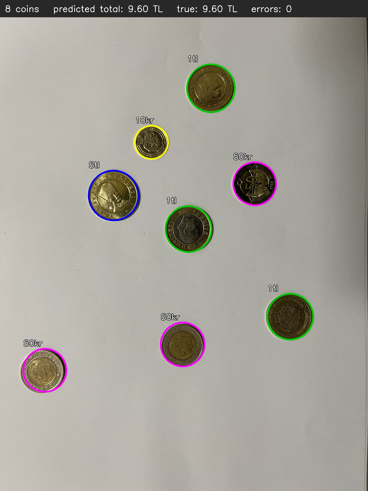
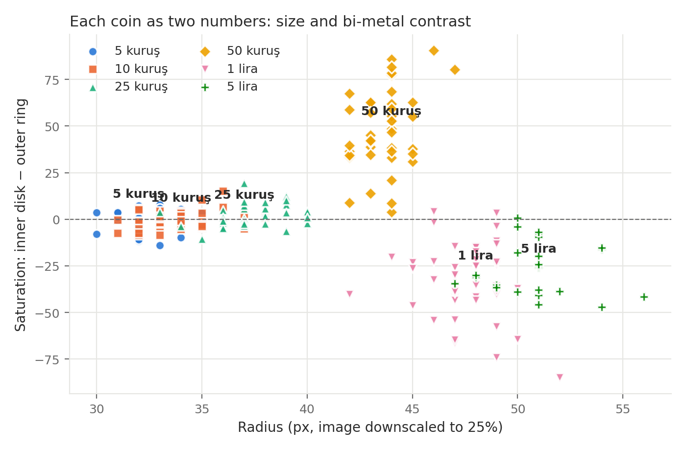
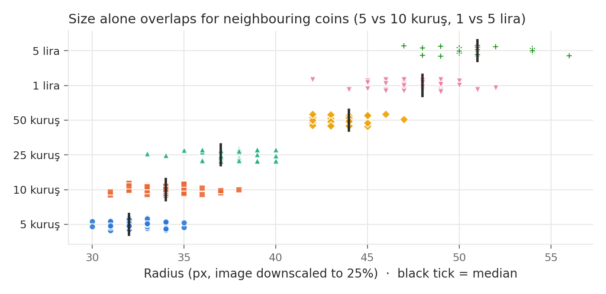
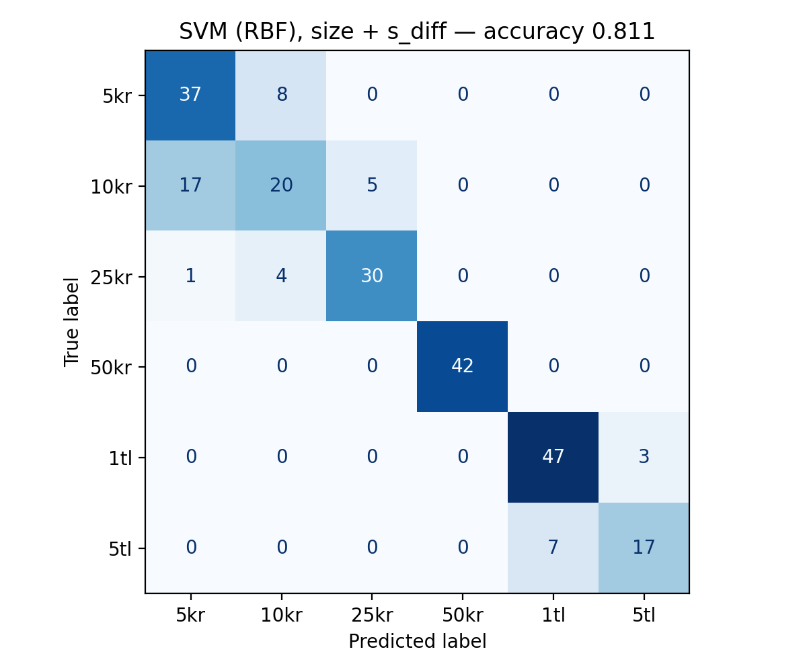
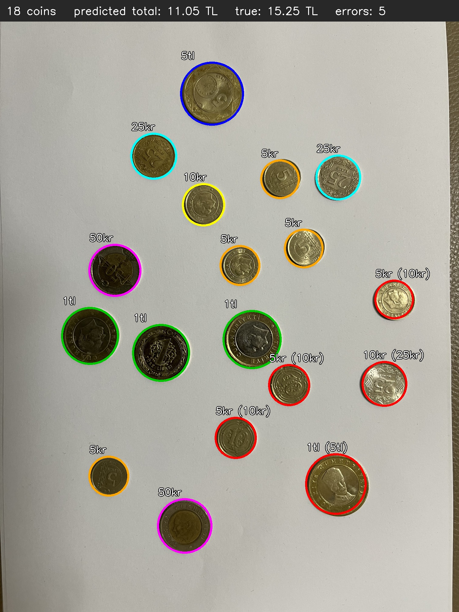
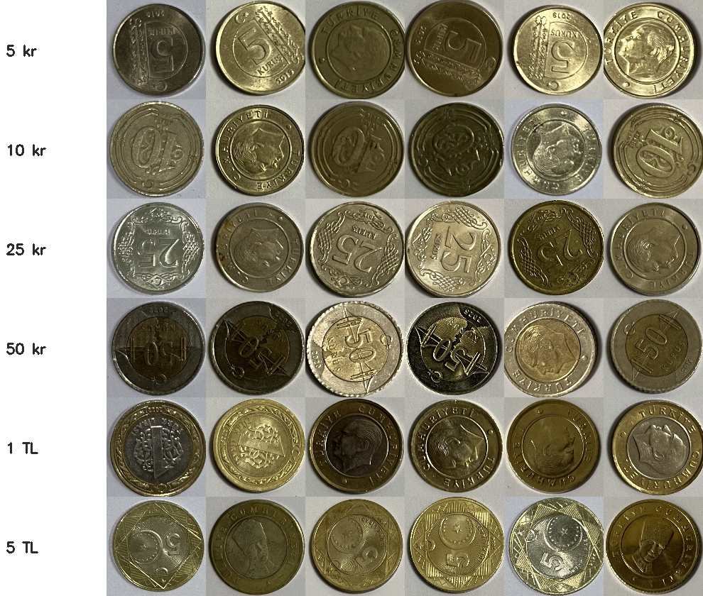

# Turkish Coin Counter

Detects every coin in a top-down photo, classifies it into one of six Turkish
coin types, and adds up the total value — using classical computer vision
(OpenCV) for detection and a small, hand-engineered feature set with
scikit-learn for classification.



*Prediction on a photo the model never saw during training: 8 coins, predicted
total 9.60 TL, true total 9.60 TL.*

## Results at a glance

| | |
|---|---|
| Dataset | 25 photos, 247 coins, 6 classes, labeled by hand |
| Detection (Hough circles) | precision **1.000**, recall **1.000** (247 / 247) |
| Classification (5-fold, grouped by photo) | accuracy **0.811** (SVM, 2 features) |
| Best class | 50 kuruş: precision and recall 1.000 |
| Hardest pair | 5 vs 10 kuruş: radius differs by only ~1.4 px |

## Pipeline

1. **Detect** — grayscale, median blur, `cv2.HoughCircles`. The radius search
   range was narrowed from 10–100 px to 20–70 px after a wide range shifted
   circles onto the inner pattern of the 5 lira coin.
2. **Label** — a small OpenCV tool (`label_tool.py`) shows each detected coin
   enlarged and records a key press. The detected radius is deliberately not
   shown, so labels come from looking at the coin, not from the feature the
   model later uses.
3. **Describe** — every coin becomes a few numbers: its radius and the mean HSV
   colour of its inner disk (0–0.5 r) and outer ring (0.7–0.9 r).
4. **Classify** — `StandardScaler` + kNN or RBF-SVM, evaluated with
   `GroupKFold`: every coin is predicted by a model that never saw any coin
   from the same photo.
5. **Count** — sum the values of the predicted classes.

## What I learned from the experiments

| Features | kNN (k=5) | SVM (RBF) |
|---|---|---|
| radius only | 0.756 | 0.765 |
| radius + 6 raw HSV values | 0.613 | 0.731 |
| radius + inner/outer saturation | 0.748 | 0.769 |
| **radius + saturation difference (`s_diff`)** | 0.765 | **0.811** |

**More features made the model worse.** Adding all six raw colour values
dropped kNN from 0.756 to 0.613: after scaling, six noisy colour features
outweighed the single, most informative size feature, and brightness depends
more on lighting than on the coin.

**One feature designed from the problem worked better.** 50 kuruş, 1 lira and
5 lira are bi-metallic. The difference between inner and outer saturation
(`s_diff = s_in − s_out`) is strongly positive for 50 kuruş (gold centre,
silver ring), negative for 1 lira (silver centre, gold ring) and near zero for
single-metal coins. It is also more robust to lighting than the raw values,
because a lighting change shifts both regions together.



**I tested a hypothesis before acting on it.** The photos were taken by hand,
so I suspected camera-height changes were the main source of size errors.
Measuring it showed the 50 kuruş radius varies by only 1.2 px (std) across
photos. The remaining errors come mostly from per-coin radius precision, which
is about the same size as the gap between 5 and 10 kuruş.



## Error analysis



All 45 errors are between coins that are close in size: 5 ↔ 10 kuruş (25),
10 ↔ 25 kuruş (9), 25 → 5 kuruş (1) and 1 ↔ 5 lira (10). 50 kuruş, the coin
with the most distinctive bi-metal pattern, is never misclassified.

The photo-level metric is strict: with ~10 coins per photo and ~81 % per-coin
accuracy, one mistake is likely, so the total is exactly right for only 4 of
the 16 photos that could be evaluated.



*Red circles are mistakes, shown as `predicted (true)`.*

## Data collection

- 25 photos on white paper under indoor ceiling light, no flash, coins not
  touching, heads/tails mixed by shaking the coins before each shot.
- Near-duplicate and flash shots were removed. Two photos of the same layout
  flipped over are kept in the same cross-validation group to prevent leakage.
- Ground truth was counted by hand per photo (`data/labels.csv`), independently
  of the detector, and compared with the per-coin labels (`check_labels.py`).
  This check found two coins that I had missed in the manual count.
- 9 coins whose type I could not identify by eye were marked `unsure` and left
  out of training. For 5 vs 10 kuruş, the label from the enlarged crop was used
  when the two labelings disagreed.



## Limitations and next steps

- **5 vs 10 kuruş** are nearly the same size and colour. Next step: a sub-pixel
  radius estimate (fitting a circle to edge points) instead of Hough's integer
  radius.
- **Camera height** was kept roughly constant by hand. A coin of known size
  (e.g. 50 kuruş, which the colour feature identifies perfectly) could be used
  as an in-image ruler.
- **Controlled conditions only**: white paper, indoor light, non-overlapping
  coins. Photos in direct sunlight produced hard shadows and were not used.
- Small dataset (247 coins, the same physical coins appear in several photos).

## How to run

```bash
pip install -r requirements.txt

python src/detect.py          # Hough detection on the trial images
python src/label_tool.py      # label detected coins (interactive)
python src/check_labels.py    # compare with hand counts, detection metrics
python src/features.py        # radius + colour features -> data/features.csv
python src/train.py           # grouped cross-validation, confusion matrix
python src/predict.py data/raw/IMG_8505.jpg   # demo on one photo
python src/make_figures.py    # README figures
```

## Project structure

```
data/raw/        photos (JPG)          data/labels.csv   hand counts per photo
data/crops/      labeled coin crops    data/coins.csv    per-coin labels
data/features.csv                      figures/          README figures
src/             all code
```

## How this project was built

I collected and labeled the dataset, ran every experiment and checked every
result. I used an AI assistant (Claude) as a tutor: it explained the
algorithms, suggested the experiments (including the `s_diff` feature) and
wrote most of the code, which I read, ran, debugged and can explain.
